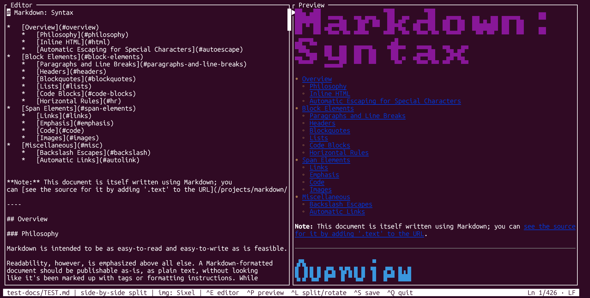
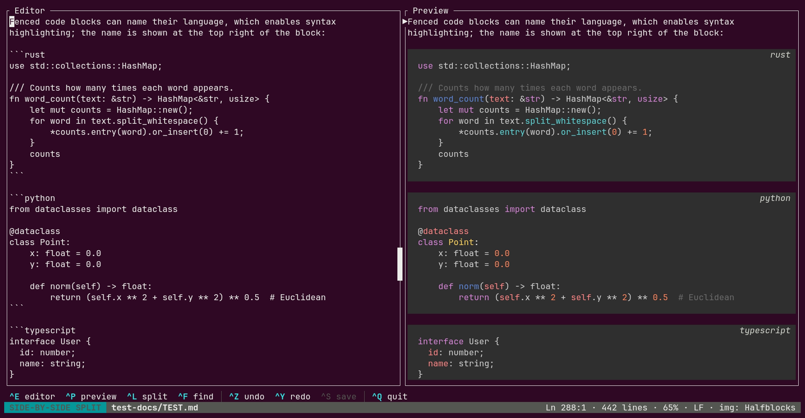
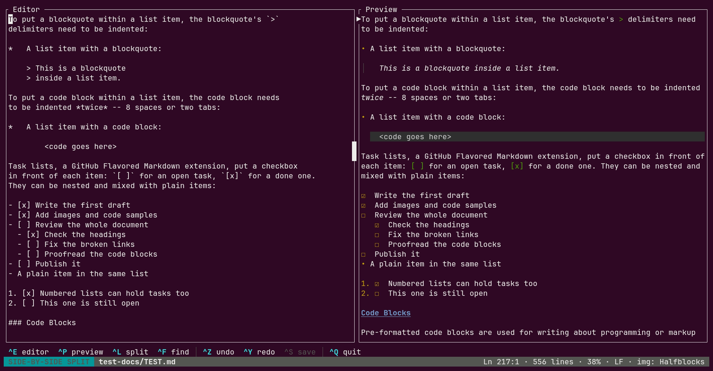
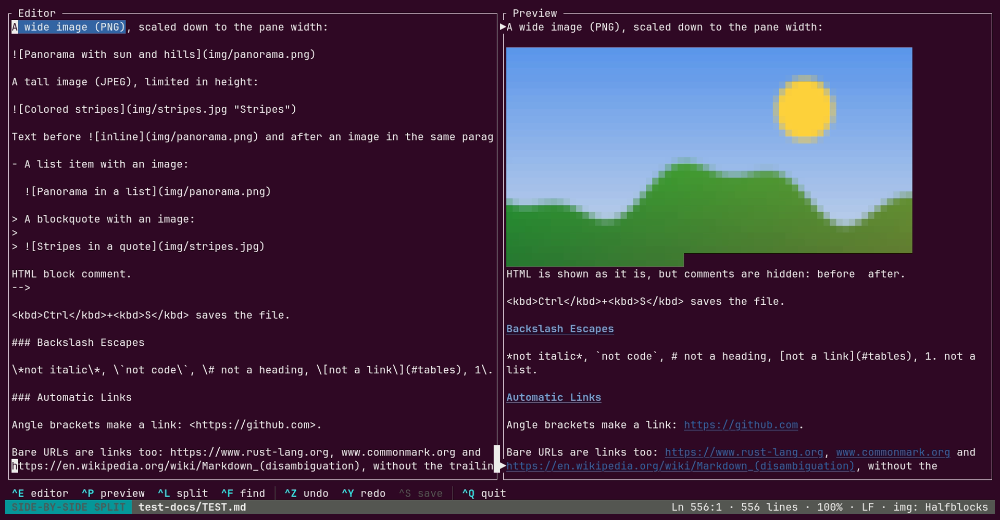

# mdedit

A Markdown editor for the terminal, written in Rust. You write on the left and see the rendered
document on the right, and the two panes scroll together line by line.



## Features

- **Editor, preview or split view.** The split can be side-by-side or stacked, and you switch with
  a single key.
- **Scroll sync.** In split view the preview follows the editor so that the cursor's line sits at
  the same height in both panes, even when headings or images take up more rows in the preview.
- **Real rendering in the terminal.**
  - H1 and H2 headings are drawn in big block letters.
  - Lists use a different bullet for each nesting level, and numbered sub-lists restart at 1.
  - Quotes keep a continuous bar, also on wrapped lines.
  - Task lists show checkboxes.
  - Bold, italic, strikethrough and inline code are styled.
- **Images.** Real images on terminals that support sixel, kitty or iTerm2 graphics, colored
  half-blocks elsewhere. A missing or remote image shows its alt text.
- **Code blocks.** Syntax highlighting for dozens of languages (Rust, Python, TypeScript, Go, Bash,
  JSON, YAML, TOML, SQL, Dockerfile, …), on a full-width background with the language name in the
  corner.
- **Links.** Clicking an internal `#anchor` link jumps to its heading (GitHub-style anchors).
  External `http(s)://` and `mailto:` links open in your browser after a confirmation prompt.
- **Mouse support.**
  - Text selection stays inside the editor, and dragging past its edge scrolls.
  - The wheel moves the cursor.
  - Links change color on hover.
- **Search.** `Ctrl+F` finds text in the document, highlighting every match and showing a match
  counter. The search is literal and case-insensitive unless the query has an uppercase letter.
- **System clipboard.** Copy and cut also go to the system clipboard through OSC 52.
- **Safe with untrusted files.** Control characters in the document are neutralized in the preview,
  so a Markdown file can't send escape sequences to your terminal.
- **Six interface languages.** English, Italian, Spanish, German, Portuguese and French, picked from
  your locale (`LC_ALL`, `LC_MESSAGES`, `LANG`) or, if unset, from the system language on
  Windows and macOS.
- **Your file stays as it was.** Line endings (LF or CRLF) are kept when you save.
- **Notices changes made by other programs.** If the file changes on disk while it's open, mdedit
  asks whether to reload it or keep your version, and it never overwrites those changes without
  asking.

## Screenshots

**Syntax-highlighted code blocks**, with the language name in the corner:



**Lists and task lists**, with a different bullet for each level, checkboxes and quotes inside list
items:



**Images** shown as real pictures on a sixel-capable terminal:



## Installation

Prebuilt binaries for Linux, Windows and macOS are attached to each
[GitHub release](https://github.com/trane77/markdown-terminal-editor/releases).

To build from source you need a recent stable Rust toolchain, which you can install with [rustup](https://rustup.rs). No system libraries are required.

```bash
git clone https://github.com/trane77/markdown-terminal-editor.git
cd markdown-terminal-editor
cargo build --release
```

The binary is `target/release/mdedit`. You can install it into `~/.cargo/bin` with:

```bash
cargo install --path .
```

## Usage

```bash
mdedit notes.md
```

If the file doesn't exist, it is created on the first save. Relative image paths are resolved from
the file's directory.

To try most features at once, open the test document:

```bash
mdedit test-docs/TEST.md
```

## Key bindings

| Keys | Action |
|---|---|
| `Ctrl+E` | Editor only |
| `Ctrl+P` | Preview only |
| `Ctrl+L` | Split view; press again to switch between side-by-side and stacked |
| `Ctrl+F` | Find; type to search, `Enter`/`↓` or `Ctrl+F` for the next match, `↑` for the previous one, `Esc` to close |
| `Ctrl+S` | Save |
| `Ctrl+Q` | Quit; with unsaved changes, asks whether to save first (`Enter`), quit anyway (`Ctrl+Q`) or cancel (`Esc`) |
| `Ctrl+C` / `Ctrl+X` | Copy / cut the selection, also to the system clipboard |
| `Ctrl+V` | Paste the last copied or cut text |
| `Ctrl+Z` / `Ctrl+Y` | Undo / redo (`Ctrl+U` / `Ctrl+R` work too) |
| `PageUp` / `PageDown` | Move the cursor by one page |
| `↑` `↓` `PageUp` `PageDown` `Home` | In preview-only mode, scroll the preview |

The other editing keys follow [tui-textarea](https://github.com/rhysd/tui-textarea)'s Emacs-style
defaults. `Ctrl+E` and `Ctrl+P` are used for switching views, so use `End` and `↑` for those moves.

With the mouse, you can click to place the cursor, drag to select, scroll with the wheel and click
links in the preview. Hold `Shift` while dragging to use your terminal's own selection instead.

## Terminal notes

- **Images.** Real images need a terminal with sixel, kitty or iTerm2 graphics, such as WezTerm,
  kitty, iTerm2, foot or Windows Terminal 1.22+. Other terminals get a half-block approximation.
  At startup mdedit asks the terminal which graphics it supports. Set `MDEDIT_HALFBLOCKS=1` to skip
  that question and always use half blocks: this helps when a terminal claims graphics it can't
  draw, or never answers (inside tmux the unanswered question swallows the first key you press).
- **Colors.** Code blocks use 24-bit color when the terminal advertises it (`COLORTERM=truecolor`
  or Windows Terminal), and the 256-color palette otherwise. The code block background assumes a
  dark terminal theme.
- **Clipboard.** Copying to the system clipboard needs a terminal that supports OSC 52, such as
  Windows Terminal, kitty, WezTerm or iTerm2. Inside tmux, enable `set-clipboard`.
- **Browser.** External links are opened with `xdg-open`, or with `wslview` or `explorer.exe` on WSL.
- **Language.** The interface language comes from `LC_ALL`, `LC_MESSAGES` or `LANG`, for example
  `LANG=de_DE.UTF-8 mdedit notes.md`. English is used when the locale isn't one of the supported
  languages.

## Development

```bash
cargo test
cargo clippy --all-targets
cargo fmt
```

The screenshots in `docs/` are generated with [VHS](https://github.com/charmbracelet/vhs) from the
tapes in `docs/tapes/`, one per screenshot. To regenerate them after a change (needs Docker and
rustup; VHS runs from its official Docker image):

```bash
scripts/screenshots.sh
```

To publish a release, run `scripts/release.sh X.Y.Z` on a clean tree: it sets the version, runs the
tests, regenerates the screenshots (needs Docker), commits, tags `vX.Y.Z` and pushes. The tag
triggers `.github/workflows/release.yml`, which builds the binaries and attaches them to a GitHub
release.

Pass one or more tapes to regenerate only those, e.g.
`scripts/screenshots.sh docs/tapes/screenshot_2_code.tape`. To add a screenshot, copy a tape, change
the text it searches for and the output file, then reference the new image here.

The code lives in `src/`:

| File | Contents |
|---|---|
| `main.rs` | App state, startup, saving |
| `input.rs` | Keyboard and mouse handling, links, clipboard |
| `ui.rs` | Drawing the panes, scrollbars, status bar and dialogs |
| `markdown.rs` | Markdown-to-preview rendering, word wrap, syntax highlighting |
| `images.rs` | Image sizing, encoding and caches |
| `i18n.rs` | Interface translations |

Built with [ratatui](https://ratatui.rs), [tui-textarea](https://github.com/rhysd/tui-textarea),
[pulldown-cmark](https://github.com/pulldown-cmark/pulldown-cmark),
[ratatui-image](https://github.com/benjajaja/ratatui-image),
[syntect](https://github.com/trishume/syntect) and [two-face](https://github.com/CosmicHorrorDev/two-face).

## License

Copyright (C) 2026 Federico Ricchiuto

mdedit is free software, released under the [GNU General Public License v3.0](LICENSE)
(`GPL-3.0-only`). You may use, modify and redistribute it, provided that you keep the copyright
notice and distribute any modified version under the same license, with its source code.
